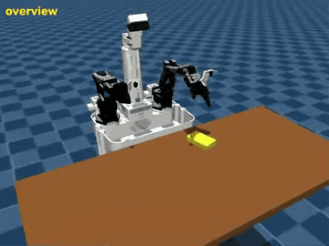
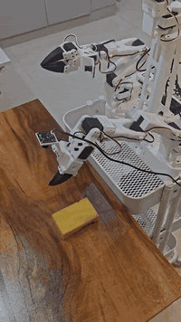
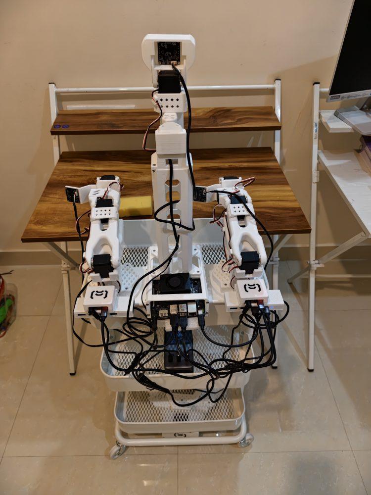
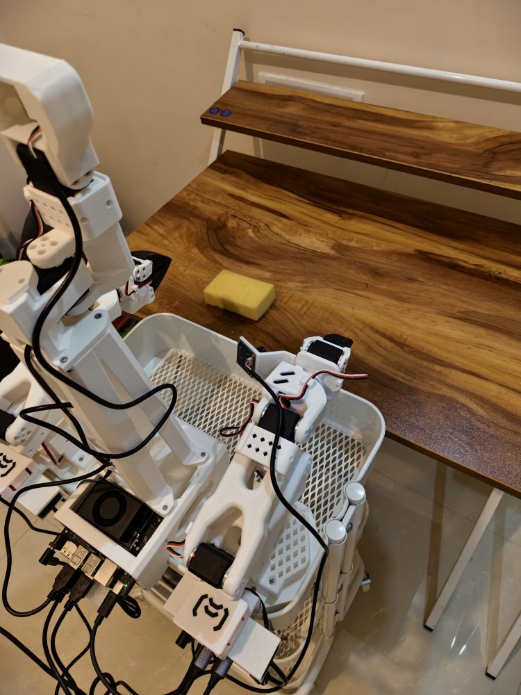
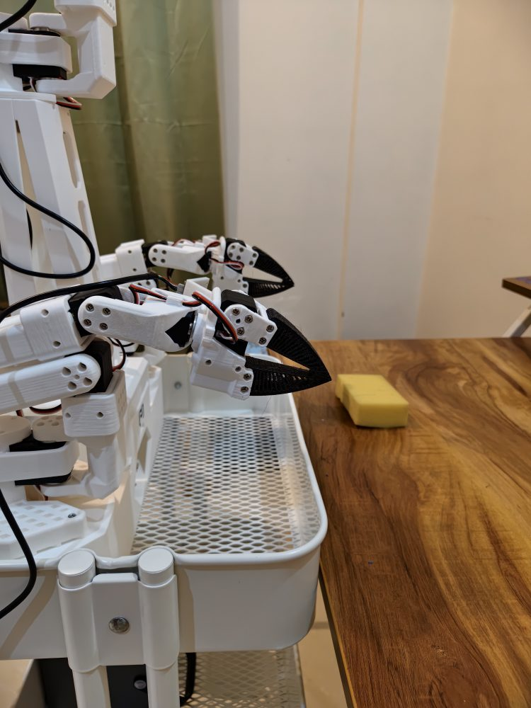
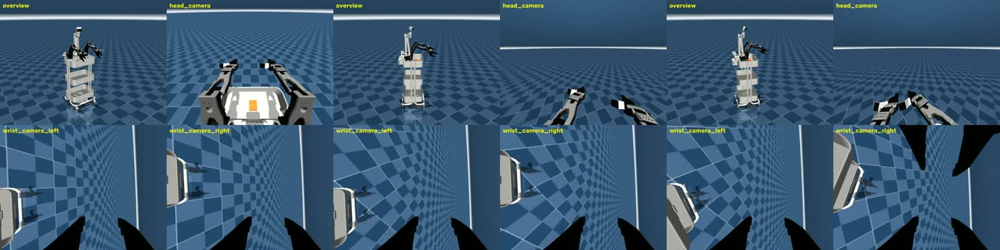
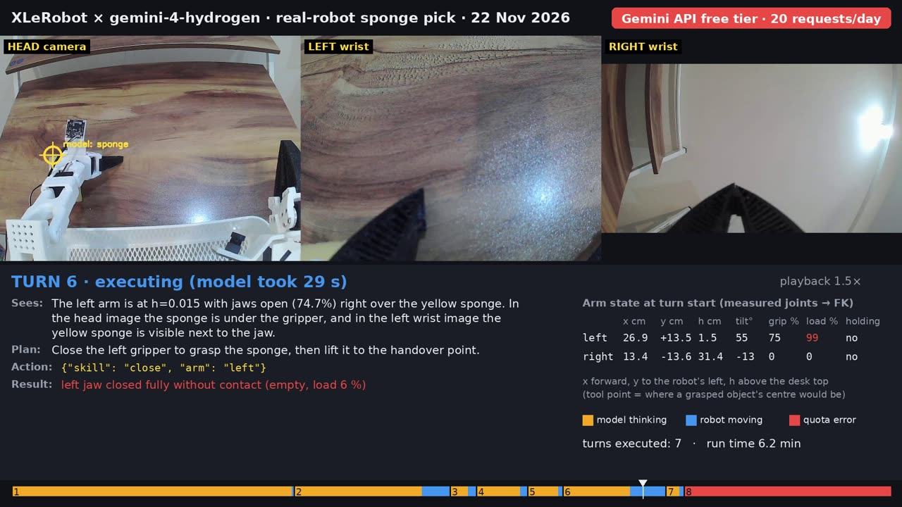

# XLeRobot sponge handover: what worked, what didn't, and what we missed

*A robotics case study · November 2026 · Prince Patel, with Claude Code · code: [`plugins/robotics/skills/xlerobot-sim`](../../plugins/robotics/skills/xlerobot-sim)*

[Background](#background) · [The setup](#the-setup) · [Simulation](#building-the-simulation) · [Sim to real](#from-sim-to-real) ·
[Runs](#runs) · [Failures](#failures-and-what-each-one-taught-us) · [Compared with the Open Gemini harness](#compared-with-the-open-gemini-4-argon-harness-what-we-missed) ·
[Closed loop with gemini-4-hydrogen](#update-22-nov-closed-loop-with-gemini-4-hydrogen-free-tier) · [Next](#what-is-next) · [Credits](#credits)

**Status: not done.** The goal was a bimanual handover on a MakerMods XLeRobot: the left arm picks a sponge from a desk, hands it to the
right arm, and the right arm puts it down. We built a MuJoCo model of the robot, ran the task in simulation, derived the sim-to-real joint
mapping, and ran two attempts on the real robot. Neither real attempt grasped the sponge. This post records what we built, every failure
with its cause, and what a comparable project that reports success did differently.

**Update, 22 Nov:** a third real attempt replaced the fixed plan with a closed loop driven by `gemini-4-hydrogen`. It reached the
sponge in 7 turns but closed beside it, and then the Gemini API free tier (20 requests per day) ended the run.
[Details and video below](#update-22-nov-closed-loop-with-gemini-4-hydrogen-free-tier).




*Left: simulation, the left arm picks and lifts the sponge (grasp attach on, see below). Right: real robot, second run, timelapse; the left
arm stops about 12 cm above the sponge.*

## Background

[XLeRobot](https://github.com/Vector-Wangel/XLeRobot) is a low-cost mobile robot: two SO-101 arms on an IKEA RÅSKOG cart with a 3-omniwheel
base and a pan/tilt head. Ours is the [MakerMods](https://github.com/makermods-robotics/MakerMods-XLeRobot) upgrade (redesigned base, neck and
mounts). Earlier we had both arms balancing ping-pong balls at the same time for about four minutes
([xlerobot-pingpong-balance](https://github.com/PrinceP/xlerobot-pingpong-balance)).

This time we used Google DeepMind's [robotics-antigravity-plugin](https://github.com/google-deepmind/robotics-antigravity-plugin): agent
skills for robot bring-up, perception, planning and sim-to-real, built around MuJoCo. It has no XLeRobot support, so we added an
`xlerobot-sim` skill on this fork (kept up to date with upstream `main`; currently plugin version 0.1.12). A closely related project, the
[Open Gemini 4 Argon Robot Harness](https://ehehee.github.io/blog/open-gemini-harness/), reports a zero-shot bimanual handover on two YAM arms;
we compare against it at the end.

## The setup

|  |  |  |
|---|---|---|

- Robot: MakerMods XLeRobot, two SO-101 arms (5 joints + gripper each, Feetech STS3215 servos, soft TPU jaws), head with two servos.
- Cameras: three Innomaker 1080p wide-angle USB cameras (head and both wrists) on one USB 2.0 hub, read at 640×480 MJPG.
- Computer: Jetson Orin on the robot, LeRobot 0.7.0. The laptop runs the simulation.
- Scene: desk top at 0.75 m, its front edge flush with the robot's top basket. Sponge 10 × 6 × 2 cm, long side pointing at the robot,
  near edge 8 cm in, centre 10 cm left of the robot's centre line. Target: the same distance in, 10 cm right of centre.

## Building the simulation

There was no MuJoCo model of the MakerMods version. The MakerMods GitHub repo has only a Bambu Studio print project (95 parts laid out on
print plates, no assembly). The [tnkr.ai project page](https://tnkr.ai/ryans-workspace/xlerobot) has an interactive 3D viewer, and its page
data points to a complete URDF package (`makermods-xlerobot-20260930`, Apache-2.0): the URDF, 28 meshes, and a licence. Two of its file
types turned out to be placeholders: the jaw `.ply` collision meshes are S3 "Access Denied" pages.

[`build_xlerobot_mjcf.py`](../../plugins/robotics/skills/xlerobot-sim/scripts/build_xlerobot_mjcf.py) turns the URDF into a MuJoCo model and
fixes what the URDF gets wrong:

| Issue in the URDF | Fix |
|---|---|
| 74.9 kg in the cart body, 4.35 kg neck, 3.2 kg head | 12 kg total (XLeRobot docs, v0.3); neck 0.6 kg, head 0.35 kg, cart + base the rest |
| Jaw collision meshes missing (the broken `.ply`) | Thin jaw contact pads, parallel at a 0.9 rad opening, TPU-like friction |
| No servo model | STS3215: armature 0.028, damping 0.6, kp 998, position actuators named like LeRobot's XLeRobot motors |
| Gripper at full servo force | Limited to 0.5 N·m, like the real load-limited squeeze |
| Camera links only | `head_camera`, `wrist_camera_left/right`; wrist cameras along the gripper, sideways image like the real ones |
| Cart convex hull would be a solid block | Cart visual only, plus invisible trays on the three basket floors |

It passes the plugin's static `mujoco-audit`, every servo joint tracks to < 0.001 rad, and the base drives and turns
([video](media/sim_drive_look_wave.mp4)).



## From sim to real

The MakerMods URDF uses the older SO-101 zero (arm stretched forward, radians); LeRobot reports calibrated degrees (0 = middle pose). We
derived the mapping by matching the URDF against LeRobot's `so101_new_calib` model in many random poses until every link pointed the same
way (0.00° error):

```
real_deg = degrees((sim_rad - OFFSET) / SIGN)
SIGN   = [+1, -1, +1, +1, -1]        # shoulder_pan, shoulder_lift, elbow_flex, wrist_flex, wrist_roll
OFFSET = [0, pi/2, pi/2, 0, 0]       # same for both arms
```

On the real robot we checked the wrist roll direction: +15° of real roll rotated the left wrist image by −14.4°, a pure roll.

The task runs in two steps:

1. [`xlerobot_handover_sim.py`](../../plugins/robotics/skills/xlerobot-sim/scripts/xlerobot_handover_sim.py) plans in simulation: head
   camera → yellow-blob detector → ray onto the desk plane for the sponge position; inverse kinematics (damped least squares over the 5
   arm joints, several seeds) for every pose; straight-line moves for approach, descent and lift, solved point by point on one IK solution.
   It exports the joint plan to JSON.
2. [`xlerobot_real_plan.py`](../../plugins/robotics/skills/xlerobot-sim/scripts/xlerobot_real_plan.py) runs that plan on the robot: converts
   to calibrated degrees, checks every target against the calibrated joint range (`--dry`), moves slowly with sag compensation, squeezes by
   load, stops on motor temperature, records all three cameras, and pauses at checkpoints (ready, hover, bottom of the descent, present,
   approach) so a person confirms alignment before any contact.

## Runs

| # | Where | What happened | Result |
|---|---|---|---|
| S1 | sim, long side along the desk edge | Head-camera estimate 3 mm off, IK 2 mm; but the tilted jaws open in a near-vertical plane and cannot straddle the sponge, and the jaws had no collision | ✗ |
| S2 | sim, sponge turned 90° | Perception 20 mm off (side face biases the blob), jaw lands on the sponge | ✗ |
| S3 | sim, true position | Jaws close beside / on top of the sponge; full-force wedge squeezes it out | ✗ |
| S4 | sim, grasp attach | Left picks, lifts and presents ✓; right's jaws never close on it (45° skew, see below) | ✗ |
| R1 | real, 14:26 | Ready ✓, hover ✓ (confirmed by eye), descent ✓ (joints within 0.5°); squeeze stopped after 9° (load spike at start of motion) | ✗ |
| R2 | real, 14:30 | Squeeze fixed; descent ended with the jaws ~12 cm **above** the sponge; jaws closed on air (91°, load 5 %) | ✗ |

Videos: R1 [phone, 2×](media/real_run1_phone_2x.mp4), [robot cameras, 4×](media/real_run1_robot_cams_4x.mp4) ·
R2 [phone, 2×](media/real_run2a_phone_2x.mp4), [phone](media/real_run2b_phone.mp4), [phone](media/real_run2c_phone.mp4),
[robot cameras, 8×](media/real_run2_robot_cams_8x.mp4) · sim [handover with grasp attach](media/sim_handover_attach_run.mp4) ·
sim failures [01–04](../../plugins/robotics/skills/xlerobot-sim/assets/videos/failures/).
Robot-camera layout: head | left wrist | right wrist (the right wrist camera is black: three cameras on one USB 2.0 hub at 640×480).

## Failures, and what each one taught us

**1. The model was not our robot (R2, the 12 cm miss).** The arms reached their joint targets within 0.2°, yet the jaws stopped 12 cm above
the sponge. Our arm bases sit at 0.86 m; MakerMods' URDF has them at 0.744 m, 11.6 cm lower. Every target was computed for a robot that does
not exist. `--arm-raise 0.116` now models our build, but with the arms higher the sponge sits at the edge of reach (the descent ends
12.6 mm off in sim), so the plan needs re-tuning before another real run.

**2. A squeeze that stops at the first load spike (R1).** The gripper's load reading jumps just from starting to move. Closing until
"load > threshold" stopped after 9°. Fix (as in our ping-pong code): contact only when the load is high and the jaw has stopped moving.

**3. Five joints cannot hand over a flat 6 cm sponge cleanly (S4).** Each SO-101 has 5 arm joints, so the gripper always points along its own
arm's heading, and 11 cm into the desk it must tilt ~60° (the wrist would need to be 0.31 m from the shoulder to point straight down;
upper arm + forearm are 0.25 m). A sponge gripped across its width lies along the holder's heading, and at any point both arms reach their
headings differ by ~45°. The receiving grasp is skewed ~45°: the sponge is ~8 cm diagonally, the jaws open ~7.5 cm.

**4. Rigid simulation cannot grip a sponge like real jaws do (S1–S3).** MuJoCo bodies are rigid; a rigid box between thin rigid pads only
touches at edges and gets wedged out, and the moving jaw's arc comes down on the sponge's top edge. Real sponge squashes and TPU jaws flex.
We used a grasp attach (a weld that engages only when both jaw pads touch the object) to check the task sequence, and say so.

**5. Perception that sees the side face (S2).** From behind, the blob includes the sponge's near side, which biased the centre by ~20 mm.
Using the blob's far edge (top-face height) and near edge (desk height) helped; on the real robot we used the tape-measured position.

## Compared with the Open Gemini 4 Argon harness: what we missed

That project reports "Gemini handed over and placed a tape roll and a metal spring clamp with no task-specific training or demonstrations".
Its own log is more careful: six development runs, one clean success (metal clamp, 18 model turns, 8 min 23 s), one success after a drop
and re-pick (tape), failures on a fan and a plastic clamp, three sessions ended by hardware faults, and "case studies rather than a
controlled success-rate benchmark". It is a real result, and the differences explain most of our failures:

| | Open Gemini harness | This attempt |
|---|---|---|
| Arms | two YAM, 6 joints each | two SO-101, **5 joints** each |
| Robot model | their bench reconstructed in sim, planning model agrees with the arms to 0.04 mm | MakerMods' URDF, **not our build** (arms 11.6 cm off) |
| Cameras | calibrated: overhead ZED Mini (stereo depth) + wrist D405, extrinsics to the arm base | uncalibrated wide-angle USB; position by tape measure |
| Loop | re-observe after **every** segment; Gemini picks the next step; plans re-solved from measured state | fixed plan executed open-loop, human checkpoints |
| Grasp | "close until contact", a holding flag checked on both arms after every step | load threshold (buggy in R1), no holding check on the real robot |
| Handover rule | receiver closes → observe → giver opens alone → recheck holding | giver opened on a timer after the receiver closed (sim only) |
| Checking | human approval of each segment in a 3D preview; optional MuJoCo collision checker | human approval at checkpoints |
| Objects | tape roll, metal clamp (thin fan and plastic clamp failed) | flat, soft 6 cm sponge |

What we missed, in order of impact:

1. **Model the actual rig before planning.** Measure mount heights, base, desk and cameras on the real robot and fit the sim to them. Our
   12 cm miss was a single unmeasured number.
2. **Calibrate the cameras to the arms** (hand-eye), so targets come from what the robot sees, not from a tape measure.
3. **Close the loop between segments.** Re-observe after every move and correct, instead of executing a precomputed plan; check "holding"
   on both arms before the giver lets go.
4. **Pick the object and grasp for the arm.** With 5 joints the handover must be designed around the heading skew: a narrower object, a
   pose where both headings agree, or a re-grasp.

## Update (22 Nov): closed loop with gemini-4-hydrogen (free tier)

[](media/hydrogen_free_tier_run_demo.mp4)

*[Demo video (1 min)](media/hydrogen_free_tier_run_demo.mp4): head, left wrist and right wrist cameras; the model's observation, plan,
action and result per turn; the measured arm state; the model's sponge point on the head view (yellow cross); a turn timeline. Waiting
for the model plays at 12×, robot motion at 1.5×. Tagged "Gemini API free tier · 20 requests/day".*

We ported the idea of the open harness to XLeRobot in
[`xlerobot_gemini_loop.py`](../../plugins/robotics/skills/xlerobot-sim/scripts/xlerobot_gemini_loop.py) and ran it on the real robot
with `gemini-4-hydrogen`, called directly through the Gemini API. Each turn the model gets the head and both wrist images plus the
measured arm state (tool position from forward kinematics, gripper opening and load, a holding flag) and picks **one** skill: `move_to`,
`nudge` (≤ 3 cm), `roll`, `open`, `close`, `fold`, `look` or `done`. Before any motion the harness solves IK in the `xlerobot-sim` model
(`--arm-raise 0.116`) and refuses targets that miss by more than 8 mm, leave the workspace, put a jaw tip into the desk, add a MuJoCo
contact (arm–arm, arm–desk, arm–body) along the move, or leave the calibrated joint range. Refusals go back to the model.

| Turn | Model | Hydrogen chose | Result |
|---|---|---|---|
| 1 | 119 s | open left gripper 75 % | opened (but see below: it stalled on its end stop) |
| 2 | 54 s | `move_to` left, hover 8 cm above the sponge prior, tilt 55° | reached, 3 mm off |
| 3 | 8 s | nudge back 3 cm, left 2 cm, down 2 cm | reached, 1 mm off |
| 4 | 19 s | nudge left 2 cm, down 2 cm | reached, 1 mm off |
| 5 | 13 s | nudge down 2.5 cm (grasp height, 1.5 cm above the desk) | reached, 1 mm off |
| 6 | 29 s | close | **empty**: the jaws closed fully, load 6 % |
| 7 | 6 s | lift 3 cm to re-align ("tool point too far forward / right") | reached |
| 8 | – | – | **HTTP 429**: free-tier daily quota used up; the run stopped, the arm held its pose |

What we learned:

1. **The loop works and every move landed where it was sent** (≤ 3 mm by the joint readings), and the model's corrections went the
   right way. The model is slow under load: 6–119 s per turn, with HTTP 503 "high demand" retries.
2. **The grasp missed because the jaws went past the sponge.** In the head view the sponge sat under the wrist, a few cm closer to the
   robot than the jaws. The wrist camera looks along the gripper and cannot see under its own jaws, so the model read a yellow sliver at
   the image edge as "between the jaws". Next: each turn, have the model point at the sponge **and** the jaw tips in the head image
   and report the offset between them, so it moves by a measured offset, not a guess.
3. **The free tier cannot finish this task.** `gemini-4-hydrogen` allows 20 requests per day on the free tier, and retries count too. A
   pick, handover and place needs about 30–45 turns, so a full run needs billing on the key's project.
4. **Opening the gripper to 75 % stalled the servo on its end stop** (99 % load until the close, about 3 minutes; it stayed at 35 °C).
   The harness now opens to at most 65 % and backs off if the load stays high.

The run's logs (per-turn images, state, model reply, result) and the full-length videos of each camera stay on the robot computer; the
demo is rendered from them with
[`xlerobot_gemini_demo_video.py`](../../plugins/robotics/skills/xlerobot-sim/scripts/xlerobot_gemini_demo_video.py).

## What is next

The closed loop is in place (see the update above); the remaining work follows the
[working notes](../../notes/xlerobot-gemini-next-steps.md):

1. **Head-camera calibration** to both arm bases (the plugin's `so101-calibration` skill is a starting point), and the model pointing
   at both the sponge and the jaw tips in the head image each turn, so it corrects by a measured offset.
2. **Billing on the Gemini key** (a full run needs about 30–45 model calls; the free tier allows 20 per day).
3. **Single-arm pick and place** of a rigid, narrow object (3–4 cm).
4. **Handover** with a holding check from gripper position and load on both arms: receiver closes → observe → giver opens only after the
   receiver is confirmed → check again.
5. **The sponge** last, with a deformable sponge in simulation (MuJoCo `flexcomp`) to replace the grasp attach.

## Reproduce

```bash
# laptop: model and plan
uv run plugins/robotics/skills/xlerobot-sim/scripts/build_xlerobot_mjcf.py
MUJOCO_GL=egl uv run plugins/robotics/skills/xlerobot-sim/scripts/xlerobot_handover_sim.py --truth --arm-raise 0.116 --export plan.json
# robot (XLeRobot host stopped; calibration split per arm): check, then run with checkpoints
python xlerobot_real_plan.py plan.json --dry
python xlerobot_real_plan.py plan.json

# closed loop with gemini-4-hydrogen (key in GEMINI_API_KEY or ~/.config/gemini/api_key, never in the repo)
python xlerobot_gemini_loop.py --dry        # one model turn, no motion
python xlerobot_gemini_loop.py              # run; Ctrl+C stops, torque stays on
# laptop: demo video from a copied log folder (rsync -a keeps the file times the timeline uses)
uv run plugins/robotics/skills/xlerobot-sim/scripts/xlerobot_gemini_demo_video.py logs/gemini_<stamp> --out demo.mp4
```

## Credits

- [google-deepmind/robotics-antigravity-plugin](https://github.com/google-deepmind/robotics-antigravity-plugin) (Apache-2.0), which this
  fork extends (merged up to upstream `main` at plugin version 0.1.12).
- MakerMods XLeRobot URDF and meshes (Apache-2.0), published with the [MakerMods XLeRobot project on tnkr.ai](https://tnkr.ai/ryans-workspace/xlerobot);
  [MakerMods-XLeRobot](https://github.com/makermods-robotics/MakerMods-XLeRobot) print files (MIT).
- [XLeRobot](https://github.com/Vector-Wangel/XLeRobot) (Apache-2.0) and its [documentation](https://xlerobot.readthedocs.io).
- SO-101 by [TheRobotStudio](https://github.com/TheRobotStudio/SO-ARM100) (Apache-2.0); [LeRobot](https://github.com/huggingface/lerobot).
- [Open Gemini 4 Argon Robot Harness](https://ehehee.github.io/blog/open-gemini-harness/) for the comparison.

[Back to top ↑](#xlerobot-sponge-handover-what-worked-what-didnt-and-what-we-missed)
