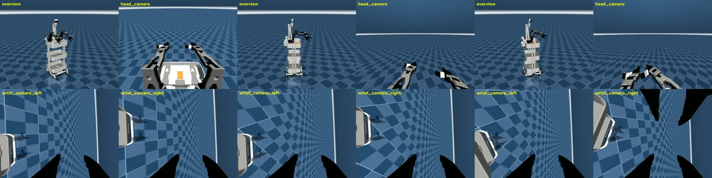

# MakerMods XLeRobot in MuJoCo



The model is `assets/makermods_xlerobot/scene.xml` (robot: `xlerobot.xml`). It is generated from MakerMods' URDF package
(`assets/makermods_xlerobot/xlerobot.urdf` + `meshes/`, Apache-2.0) by
[build_xlerobot_mjcf.py](scripts/build_xlerobot_mjcf.py); edit the script, not the XML. Sources, every change made and known gaps
are in [model_notes.md](references/model_notes.md).

## Quick start

```bash
uv run scripts/build_xlerobot_mjcf.py                                   # regenerate xlerobot.xml + scene.xml from the URDF
MUJOCO_GL=egl uv run scripts/xlerobot_sim_demo.py --out demo.mp4        # drive, look, wave; records overview + 3 cameras
uv run scripts/xlerobot_sim_demo.py --viewer                            # interactive viewer
python -m mujoco.viewer --mjcf assets/makermods_xlerobot/scene.xml      # plain viewer, actuator sliders in the UI
```

## Model at a glance

| | |
|---|---|
| Mass | 12.0 kg total (XLeRobot docs: ~12 kg); arms 0.80 kg each, head 0.35 kg, neck 0.6 kg, cart + base + power bank the rest |
| Base | planar joints `root_x_axis_joint`, `root_y_axis_joint` (world frame), `root_z_rotation_joint` (yaw); velocity actuators `base_x`, `base_y` (±0.5 m/s), `base_yaw` (±1.5 rad/s). Use `drive_base()` in the demo for robot-frame commands. Wheels are not simulated. |
| Arms | `right_arm_{shoulder_pan, shoulder_lift, elbow_flex, wrist_flex, wrist_roll, gripper}` and `left_arm_*` position actuators (LeRobot XLeRobot motor names) on URDF joints `Rotation, Pitch, Elbow, Wrist_Pitch, Wrist_Roll, Jaw` (right) and `*_2` (left), in radians |
| Head | `head_motor_1` (pan, `head_pan_joint`), `head_motor_2` (tilt, `head_tilt_joint`) |
| Servos | Feetech STS3215 model: armature 0.028, damping 0.60, frictionloss 0.052, kp 998.22, kv 2.731, ±3.35 N·m; joints track to <0.001 rad |
| Cameras | `head_camera`, `wrist_camera_right`, `wrist_camera_left`; fovy 100° (130° diagonal wide lens, pinhole approximation) |
| Collision | arms: mesh hulls. Cart: visual only, plus thin trays on the three basket floors (z 0.111, 0.391, 0.666 m) so objects rest in them |

## Conventions and cautions

- **Joint angles are URDF radians, not LeRobot degrees.** The URDF uses the older SO-101 zero (arm stretched forward); positive
  `shoulder_lift`/`elbow_flex` raise the arm. Mapping to a real robot's calibrated degrees is not done yet (model_notes.md §4).
- The real wrist cameras sit beside the fixed jaw; with the gripper level, world-up shows at an image side. The sim matches this.
- The base slides; there is no wheel–floor contact. Do not use it for traction or bump studies.
- Wide-angle real cameras are fisheye; the sim cameras are pinhole. Expect edge distortion differences.

## Using it with other skills

- `mujoco-studio-sidecar` for a live 3D view; `motion-planning` and `visual-servoing` with the arm actuators above;
  `mujoco-showcase-shot` for a turntable render of `xlerobot.xml`.
- `mujoco-audit --static_only` passes on `xlerobot.xml` (the dynamic object scenarios do not apply to a whole robot).
